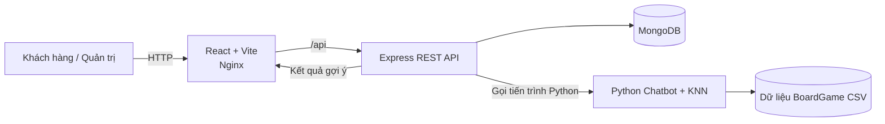

# CT550 – BoardGame Nexus

## 1. Project Overview

BoardGame Nexus là website thương mại điện tử chuyên về BoardGame, giúp khách hàng tìm hiểu và mua/thuê trò chơi, theo dõi đơn hàng và nhận hỗ trợ. Dự án kết hợp chatbot và gợi ý KNN để giúp người dùng chọn game theo nhu cầu.

## 2. My Contributions

Trong phạm vi dự án, phần việc triển khai gồm:

- Phát triển giao diện React cho khách hàng và trang quản trị.
- Xây dựng REST API bằng Express, tích hợp nghiệp vụ tài khoản, sản phẩm, đơn hàng, thuê game, voucher và blog.
- Tổ chức dữ liệu và kết nối MongoDB qua Mongoose.
- Tích hợp chatbot Python và hệ thống gợi ý BoardGame bằng KNN.
- Đóng gói các dịch vụ bằng Docker/Compose và cấu hình GitHub Actions để kiểm thử, build, publish image.

## 3. Key Features

- **Khách hàng:** đăng ký/đăng nhập, tìm và xem sản phẩm, yêu thích, giỏ hàng, đặt mua/thuê, voucher, đánh giá, blog và theo dõi tài khoản/đơn hàng.
- **Quản trị:** quản lý sản phẩm, khách hàng, đơn hàng, thuê game, voucher, nội dung và báo cáo.
- **Chatbot AI:** hỏi đáp về BoardGame, gợi ý theo số người chơi/độ tuổi/thời lượng/thể loại/giá; có luồng chuyển hỗ trợ cho nhân viên.

## 4. Technology Stack

| Nhóm | Công nghệ |
|---|---|
| Frontend | React, React Router, Vite 6 |
| Backend | Node.js 22, Express 5, Mongoose |
| Database | MongoDB 7 |
| AI/ML | Python 3, tiền xử lý CSV, KNN tự cài đặt |
| Testing | Vitest, Testing Library, Node.js Test Runner, Python `unittest` |
| DevOps | Docker, Docker Compose, Nginx, GitHub Actions, GHCR |

## 5. System Architecture



Ở local, Vite proxy `/api` tới Express. Trong Docker, Nginx ở frontend chuyển tiếp `/api` tới backend; backend đọc/ghi MongoDB và gọi Python chatbot khi xử lý hội thoại.

## 6. Frontend Development with Vite

Frontend dùng React với Vite: `npm start` chạy development server tại cổng `5173`; Vite proxy API theo `VITE_DEV_API_TARGET`. `npm run build` tạo bản production trong `dist/`, sau đó Nginx phục vụ SPA. `VITE_API_BASE_URL` cấu hình API base lúc build.

## 7. Backend & API Development

Express cung cấp REST API dưới `/api`, chia theo các nhóm như `/auth`, `/products`, `/orders`, `/rentals`, `/vouchers`, `/blog-posts`, `/admin` và `/chatbot`. Backend xử lý nghiệp vụ, xác thực/ủy quyền, kết nối MongoDB bằng Mongoose; health endpoint là `/health`.

## 8. AI Recommendation System

Dữ liệu BoardGame từ CSV được làm sạch và mã hóa thành các đặc trưng như số người chơi, độ tuổi, thời lượng, thể loại, độ khó, giá và tags. Chatbot trích xuất nhu cầu từ câu hỏi, tạo vector đặc trưng, dùng KNN khoảng cách Euclid để xếp hạng Top-K game phù hợp. Kết quả có thể được đối chiếu/làm giàu với sản phẩm trong MongoDB trước khi trả về API.

## 9. Docker & Containerization

- [Dockerfile](Dockerfile): build frontend nhiều giai đoạn bằng Node/Vite, phục vụ bản build qua Nginx.
- [server/Dockerfile](server/Dockerfile): đóng gói Node.js, Python và mã nguồn chatbot trong backend container.
- [nginx.conf](nginx.conf): cấu hình SPA fallback và reverse proxy API.
- Cấu hình môi trường mẫu nằm trong [.env.example](.env.example). Đổi `JWT_SECRET` trước khi sử dụng thực tế; không commit secrets.

## 10. Docker Compose

[docker-compose.yml](docker-compose.yml) khởi chạy ba service: `frontend`, `backend`, `mongodb`. Các service giao tiếp trong mạng Compose; MongoDB dùng volume `mongodb_data`. Health check điều phối thứ tự khởi động.

```sh
docker compose up --build
```

Mặc định website ở http://localhost:8080 và API health ở http://localhost:5000/health. Dừng bằng `docker compose down`; `docker compose down -v` sẽ xóa cả dữ liệu MongoDB.

## 11. CI/CD Pipeline with GitHub Actions

Workflow [.github/workflows/ci-cd.yml](.github/workflows/ci-cd.yml) chạy khi push hoặc pull request vào `main`/`master`:

1. Cài dependencies, chạy frontend tests và build Vite.
2. Chạy backend tests và Python `unittest`.
3. Khi push `main` và các job kiểm tra thành công, build rồi publish image frontend/backend lên GHCR với tag `latest` và commit SHA.

Pipeline hiện build/publish image, **chưa tự deploy lên server**. Workflow trên repository đích đã chạy thành công cho commit `76e32e1`, gồm frontend checks, backend checks và build/publish Docker images.

## 12. Testing & Quality Assurance

Các lệnh kiểm thử:

```sh
npm run test:ci
npm run build
npm test --prefix server
python -m unittest discover -s py -p "test_*.py"
```

Kết quả đã xác minh tại môi trường local: frontend 11/11 test đạt; backend 8/8 test đạt; Vite build thành công (có cảnh báo bundle JavaScript lớn hơn 500 kB). Docker Compose build và khởi động đủ ba service thành công; đã kiểm tra chatbot trả kết quả qua API trong container. GitHub Actions trên repository đích cũng đã hoàn tất thành công, bao gồm bước publish image GHCR.

## 13. Installation & Deployment

**Yêu cầu:** Node.js 22+, npm, Python 3; hoặc Docker Engine/Desktop và Docker Compose.

Chạy local từ thư mục gốc:

```sh
npm ci
npm ci --prefix server
npm run server
```

Trong terminal khác chạy frontend:

```sh
npm start
```

Backend cần MongoDB local và cấu hình `server/.env` (tham khảo `server/.env.example`). Để chạy trọn bộ bằng Docker, copy `.env.example` thành `.env`, đặt secret riêng rồi chạy `docker compose up --build`. Production deployment cần cấu hình secrets, domain/TLS và hạ tầng riêng.

## 14. Screenshots & Demo

Ảnh hiện có trong repository là ảnh BoardGame/logo, chưa có ảnh chụp màn hình website, trang quản trị hoặc chatbot. Có thể chạy theo hướng dẫn ở trên để xem demo local tại http://localhost:8080 (Docker) hoặc http://localhost:5173 (Vite development).

## 15. Project Information
- **Tên người thực hiện:** Phan Thanh Hưng.
- **MSSV:** B2205874.
- **Dự án:** CT550 – BoardGame Nexus.
- **Vai trò:** phát triển full-stack, tích hợp AI và thiết lập quy trình đóng gói/CI.
- **Thời gian:** chưa được ghi trong repository; bổ sung mốc thời gian thực tế khi chốt báo cáo.
- **GitHub:** [phanthanhhung312it/CT550](https://github.com/phanthanhhung312it-design/CT550).
